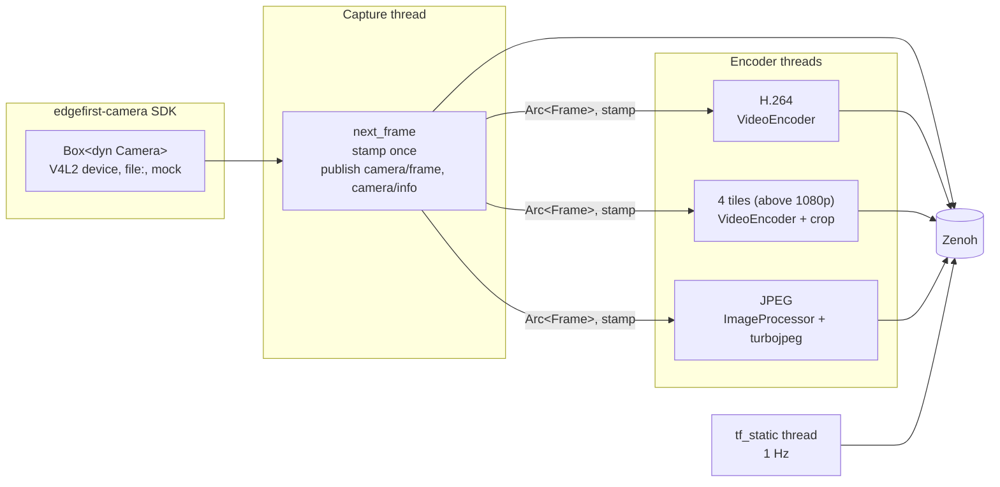

# EdgeFirst Camera Node - Architecture

**Technical architecture documentation for developers**

This document describes how the EdgeFirst Camera Node is built: its threads, how frames and their buffers move between them, and the design decisions behind them. For user-facing documentation, see [README.md](README.md). The capture library it is built on, the `edgefirst-camera` SDK, has its own [architecture document](crates/camera/ARCHITECTURE.md).

---

## Table of Contents

1. [System Overview](#system-overview)
2. [Startup](#startup)
3. [Threads](#threads)
4. [Buffers and Backpressure](#buffers-and-backpressure)
5. [Encoding](#encoding)
6. [Messages](#messages)
7. [Timestamps](#timestamps)
8. [Record and Replay](#record-and-replay)
9. [Instrumentation and Profiling](#instrumentation-and-profiling)
10. [References](#references)

---

## System Overview

The service captures frames through the `edgefirst-camera` SDK and publishes them on Zenoh: every frame by reference as an `edgefirst_msgs/CameraFrame`, and compressed as JPEG and H.264. The SDK owns the camera: device negotiation, buffer pools, controls, and the acquisition time of each frame. The HAL does the pixel work: `edgefirst-image` converts and scales (OpenGL, G2D or CPU, chosen per conversion), and `edgefirst-codec` encodes H.264 on the platform's V4L2 memory-to-memory encoder. JPEG compression is turbojpeg.



| Module | Role |
|---|---|
| `main.rs` | Argument parsing, logging, the Zenoh session, signals, and the startup sequence |
| `args.rs` | Command-line flags and their environment variables, and the empty-variable scrub for systemd `EnvironmentFile`s |
| `source.rs` | The request built from the command line, opening and starting the source, the capture pool, mirroring, and the retry while the ISP is not ready |
| `pipeline.rs` | The capture loop, publishers, encoder threads, drop reports and `tf_static` |
| `encode.rs` | H.264 stages for the main stream and the tiles |
| `jpeg.rs` | The JPEG stage |
| `messages.rs` | `camera/info`, `tf_static`, the compressed image and video payloads, and the Zenoh sample timestamp |

The application is Linux-only for now (Unix signals, journald); the SDK also builds on macOS and Windows.

---

## Startup

1. **Arguments.** Empty environment variables are removed before parsing, so `KEY=""` in `/etc/default/camera` means unset. Combinations that cannot work (`--record` without `--h264`, or with a `file:` source) fail before anything opens.
2. **Request.** `source::Request` resolves the source (`--source`, else the hidden 2.x `--replay` as a `file:` source, else `--camera`), the requested size and rate, the pool depth, the memory strategy, mirroring and controls. A `CAMERA_MODE` is checked against the modes the camera reports (`edgefirst_camera::probe`) and expands to a size and rate; explicit `CAMERA_SIZE` and `CAMERA_FPS` win over it with a warning. File and mock sources cannot report modes, so a mode there is an error. Devices are asked for YUYV, which the encoders and converters take directly; a device that does not offer it is captured in its current format.
3. **Open.** `source::open` opens the camera, applies mirroring, provides the capture pool and starts streaming (see [Buffers](#buffers-and-backpressure)). It retries while the SDK reports `NotReady` (`ENOENT` on open, or no first frame within the SDK's timeout, as when `isp_media_server` has not started serving the device), within a 15 s budget and six attempts, so a wedged ISP lands the unit in `failed` within systemd's start limit instead of hammering it. Every other error fails startup. A shutdown during the retry exits cleanly.
4. **Pipeline.** `pipeline::run` opens the encoders, the recording if any, and the publishers, then runs the capture loop. An encoder that cannot open is a startup error.

The tokio runtime serves signal handling and the tokio console only. Capture and encoding run on plain threads: the image crate's GL converter blocks on its worker, which a tokio runtime thread may not do, and Zenoh's synchronous API (`Wait`) needs no runtime.

---

## Threads

| Thread | Work |
|---|---|
| main (capture) | `next_frame`, one stamp per frame, `camera/frame` and `camera/info`, `try_send` to the encoders, the forwarded H.264 of a `file:` source, drop reports |
| `h264` | Converts if needed, encodes, records, publishes `camera/h264` |
| `h264_tl`, `h264_tr`, `h264_bl`, `h264_br` | One per tile: rate limit, crop or convert, encode, publish |
| `jpeg` | Converts to RGBA at the stream size, compresses, publishes `camera/jpeg` |
| `tf_static` | Republishes the camera transform every second |

Each encoder thread owns its encoder and, when it converts, its own `ImageProcessor`. Encoders are opened on the main thread before capture begins, so a missing encoder is reported at startup, and each converter is warmed with one conversion so its first-use setup (GL shader compilation) does not stall capture. Shutdown (SIGTERM or SIGINT) stops the capture loop at the next frame; dropping the channel senders ends the encoder threads, which drain their encoders and flush the recording before they are joined, and the camera is stopped.

---

## Buffers and Backpressure

### The capture pool

On camera devices the service allocates the capture pool itself, through `ImageProcessor::create_image_desc` with physically contiguous (CMA) memory, so the buffers suit every converter including G2D, and provides it to the SDK. Mock sources get a pool in any memory; file sources use the decoder's pool.

- If the device refuses the buffers at `start()` (`BuffersRejected`, for example a pitch it does not accept), the service logs the reason and slot, takes its buffers back, and starts on the SDK's own pool.
- If contiguous memory runs out (`ContiguousUnavailable`, from the allocation or from the SDK), startup fails with a message naming the shortfall and suggesting a smaller `CAMERA_BUFFERS`.
- `--memory export` skips the service's pool and uses the driver's buffers.

### Frames hold their buffers

A `Frame` holds its capture buffer until it drops; the SDK never hands a buffer back to the driver while a frame references it. The capture loop wraps each frame in an `Arc` and sends a clone to each encoder, so a buffer returns to the driver once the last encoder is done with it. Converting stages drop the frame as soon as the conversion has read it; the direct H.264 path holds it until the encoder has read it.

Because queued and in-flight frames hold buffers, the pool is `CAMERA_BUFFERS` plus two while any encoder runs. `CAMERA_BUFFERS` keeps its meaning for subscribers to `camera/frame`: they have about `CAMERA_BUFFERS - 1` frame periods to read a frame. Each encoder queue holds one frame: one absorbs encoder jitter at the H.264 encoder, and keeps the JPEG compressor, which takes longer than a frame period at 1080p, busy without waiting for the next frame. Measured on the i.MX 8M Plus at 1080p30 with H.264 and JPEG, four buffers without the encoder headroom held capture to about 25 fps; with it, capture holds 30 fps.

### Drops

`try_send` never blocks capture: a full queue drops the frame for that encoder. kanal reports a full channel as `Ok(false)` and a closed one as `Err`, and both count as drops. Frames the camera lost are counted by the SDK from timestamp gaps against the negotiated rate (`CaptureStats::dropped`), which needs a camera that reports its rate. Both are summarised in one warning per 10 s window.

At startup, the frames the camera captured while the encoders opened are discarded before the loop begins: they are stale, and the gap behind them is not a capture loss.

---

## Encoding

### H.264

A stage encodes the captured tensor directly when the encoder takes the capture format at the stream size and no software mirroring is needed. Otherwise it converts each frame first, scaling to the stream size and mirroring, into YUYV (half the bytes of RGBA, and written by the i.MX 8M Plus G2D) or, if the encoder does not take YUYV, RGBA. A direct stage that fails on its first frame switches to converting.

The encoder may return an access unit for an earlier frame, so each stage keeps the stamps of frames whose access unit has not come back, keyed by the frame's `seq` as the encoder's presentation timestamp, and publishes each access unit with its own frame's stamp. The recording is written from the same access units, flushed at every key frame.

### Tiles

Above 1080p (or with `--h264-tiles`), four more stages encode the quadrants of the frame at their own size, up to 1920x1080, on `camera/h264/{tl,tr,bl,br}` with `frame_id` suffixes `topleft`, `topright`, `bottomleft` and `bottomright`. A tile is encoded from the capture through the encoder's crop where the device can express it, which on a 4K capture is three of the four: the device reads `stride x rows` from the plane offset, which for the bottom-right quadrant runs past the end of a tightly sized buffer, so that tile converts instead. A tile pacer limits tiles to `H264_TILES_FPS`, advancing its deadline by whole intervals so the rate stays phase locked.

### JPEG

The JPEG stage converts to RGBA at the stream size (mirroring there when needed) and compresses with turbojpeg at `JPEG_QUALITY`, 4:2:0.

### Mirroring

Mirroring is requested from the camera (on vvcam, through the ISP's control). When the camera cannot mirror, or rejects the control in the current mode, the encoders mirror their outputs instead (a flip, or a 180° rotation for both axes), and tiles are taken from the quadrant their mirror image covers. `camera/frame` is then published unmirrored, with a warning at startup: raw frames cannot be mirrored without a copy. File sources are not mirrored; the recording was mirrored when it was made.

---

## Messages

All messages are ROS 2 CDR, and every message about a frame carries that frame's stamp.

| Topic | Type | Content |
|---|---|---|
| `camera/frame` | `edgefirst_msgs/CameraFrame` | The frame by reference (DMA-BUF) |
| `camera/info` | `sensor_msgs/CameraInfo` | Calibration, per frame |
| `camera/jpeg` | `sensor_msgs/CompressedImage` | JPEG at the stream size |
| `camera/h264` | `foxglove_msgs/CompressedVideo` | H.264 Annex B at the stream size |
| `camera/h264/{tl,tr,bl,br}` | `foxglove_msgs/CompressedVideo` | 4K tiles |
| `tf_static` | `geometry_msgs/TransformStamped` | Camera transform, 1 Hz |

### Camera frame

`camera/frame` is built by the SDK's `schemas` mapping (`edgefirst_camera::schema::FrameTensor`), the one definition of a `Frame` as a `CameraFrame`: the tensor-ABI storage kind and dtype codes, the format's addressing shape and C byte strides at the frame's row stride, the HAL wire name of the format (`YUYV`, `NV12`, ...), the stream's colorimetry (empty when unspecified), and one plane per image plane, so NV12 carries its chroma plane. Frames in process memory (the mock source) have no handle another process can open, so their planes travel inline.

Consumers:

1. Decode the `CameraFrame` and read its tensor.
2. Wait on `fence_fd` when it is non-negative.
3. Map each plane with `handle >= 0` through `pidfd_getfd` on the producer `pid`, then `mmap`.
4. Read `[0, used)` of each plane within about `CAMERA_BUFFERS - 1` frame periods, before the buffer is captured into again.
5. Unmap and close the imported descriptors.

### Camera info and transform

`camera/info` comes from the calibration at `CAM_INFO_PATH` (an isp-imx dewarp configuration), or nominal 1080p defaults with a warning when none is configured or it cannot be read. `tf_static` comes from `CAM_TF_VEC`, `CAM_TF_QUAT`, `BASE_FRAME_ID` and `CAMERA_FRAME_ID`. For a `file:` source both come from the recording's sidecar when it has them.

---

## Timestamps

Camera topics follow the EdgeFirst middleware timestamp contract (Perception > Clock Synchronization and Timestamps in the EdgeFirst manual): `header.stamp` is the acquisition instant as Unix time from the host `CLOCK_REALTIME`, and the Zenoh sample timestamp carries the same instant.

- **Acquisition instant.** The SDK converts the driver's capture timestamp (`CLOCK_MONOTONIC` for V4L2) to wall-clock time once, at dequeue, with `RealtimeClock`, which measures the realtime-monotonic offset at every conversion between two realtime reads, so a wall-clock step (NTP or GNSS sync on a unit without a working RTC) is followed on the next frame. `Frame::realtime()` carries the result. No exposure or readout correction is applied.
- **One stamp per frame.** The capture loop reads `Frame::realtime()` once (`schema::stamp`) and passes that `Time` with the frame to every encoder, so `camera/frame`, `camera/info`, `camera/jpeg`, `camera/h264` and the tiles carry an identical stamp. A frame whose clock cannot be converted is stamped at publication.
- **Sample timestamp.** Each message's Zenoh timestamp is `schema::ntp64` of its header stamp. Zenoh timestamps are NTP64 (32.32 fixed point, about 0.23 ns resolution), so a decoded Zenoh timestamp matches `header.stamp` to within a nanosecond rather than bit for bit.
- **Metadata.** `tf_static` is re-stamped at each republish. A `file:` source has no acquisition time; its frames are stamped at their paced delivery instant.

### ROS 2 Year 2038 Limit

The ROS 2 `builtin_interfaces/msg/Time` message uses `int32` for the `sec` field, which overflows on 2038-01-19T03:14:07Z. Every stamp is produced by `edgefirst_camera::schema::time`, which saturates times past the limit to `sec = i32::MAX`, `nanosec = 999_999_999` and clamps pre-epoch times to the epoch, so the header stamp and the Zenoh timestamp always agree. Camera data continues to be published; only the stamp is clamped.

---

## Record and Replay

A recording is a pair of files with a shared basename:

| File | Contents |
|---|---|
| `<name>.h264` | Raw H.264 Annex B, access units back to back, no container or index |
| `<name>.json` | Sidecar metadata, written once at record start |

The `.h264` file is written as the encoder produces it and flushed at every key frame, so any prefix decodes. VLC, mpv and ffplay play it directly; `ffmpeg -i in.h264 -c copy out.mp4` muxes it into MP4 without re-encoding.

### Sidecar v1

```jsonc
{
  "version":     1,
  "codec":       "h264",
  "fps":         30,              // the stream's rate; whole rates are integers
  "width":       1920,            // the encoded stream's size
  "height":      1080,
  "colorimetry": {                // empty strings are unspecified
    "color_space":    "bt709",
    "color_transfer": "bt709",
    "color_encoding": "bt601",
    "color_range":    "limited"
  },
  "camera_info": { /* CameraInfoFields: k, r, p, roi, ... */ },
  "tf_static":   { /* TfStaticFields: frames, translation, rotation */ }
}
```

The SDK's `edgefirst_camera::Sidecar` reads and writes it. `fps`, `width`, `height` and `colorimetry` describe the stream; every other field is the application's and travels as `extras`. There is no `format` field: the decoder produces NV12 whatever the capture format was. Recordings from camera 2.x replay unchanged, and 2.x reads the sidecars written here when the rate is a whole number.

### Recording (`--record <path>`)

The recording file is created and the sidecar written before any frame flows, so a recording that cannot start fails the service without an orphaned sidecar. The sidecar's size is the stream size, its rate the capture rate, its colorimetry the camera's, and its `camera_info` and `tf_static` those being published.

### Replay (`--source file:<path>`)

A `file:` source is an SDK camera like any other: the SDK decodes the recording with the platform's V4L2 decoder and paces delivery at the recorded rate, or at `CAMERA_FPS` (`REPLAY_FPS`). The pipeline treats its frames as captured frames, with these differences:

- `camera/h264` republishes the recorded access units verbatim (`Frame::encoded()`), so consumers receive the original bitstream; nothing is re-encoded. Pictures the decoder releases at the end of the stream carry no access units of their own, since the earlier frames already carried those bytes.
- `camera/frame` carries the decoded NV12 frames, and JPEG compresses them.
- `camera/info` and `tf_static` come from the sidecar.
- Outputs keep the recording's size; `STREAM_SIZE` and `MIRROR` do not apply.
- At the end of the file the service exits cleanly, or with `--replay-loop` restarts from the first frame with `seq` continuing.

---

## Instrumentation and Profiling

Logging uses `tracing` with layers for stdout (pretty), journald, the tokio console (`--tokio-console`) and Tracy (`--tracy`); `RUST_LOG` sets the filter (default INFO). The HAL's `log` output is bridged into the same subscriber.

Spans mark the work Tracy shows as zones: `camera_read` and `camera_publish` on the capture thread, `h264` (with the stage name) and `jpeg` on the encoder threads. With `--tracy`, the capture loop marks each frame and plots `fps`; the encoders mark secondary frames and plot `h264_kb` and `jpeg_kb`. The `profiling` feature adds Tracy's allocation tracking, sampling and system tracing.

---

## References

- [edgefirst-camera SDK](crates/camera/README.md) and its [architecture](crates/camera/ARCHITECTURE.md)
- [EdgeFirst HAL](https://github.com/EdgeFirstAI/hal) - `edgefirst-image`, `edgefirst-codec`, `edgefirst-tensor`
- [zenoh](https://zenoh.io/) - Pub/sub middleware
- [kanal](https://github.com/fereidani/kanal) - Bounded channels
- [V4L2 API Specification](https://www.kernel.org/doc/html/latest/userspace-api/media/v4l/v4l2.html)
- [NXP i.MX 8M Plus Reference Manual](https://www.nxp.com/docs/en/reference-manual/IMX8MPRM.pdf)
