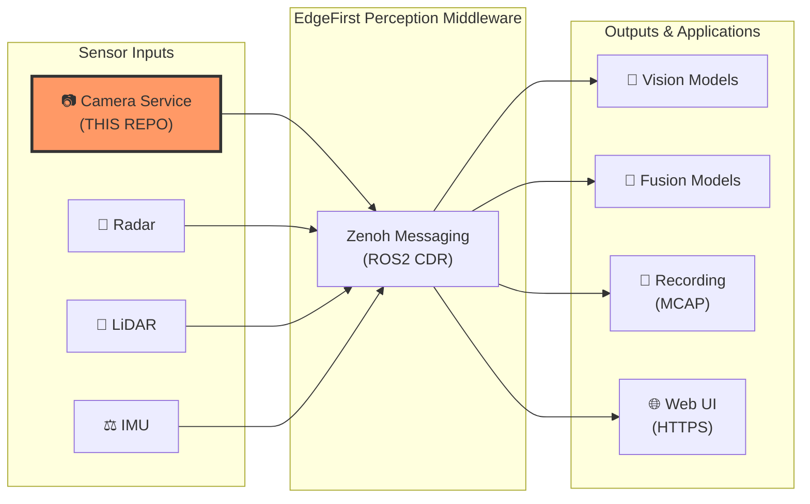
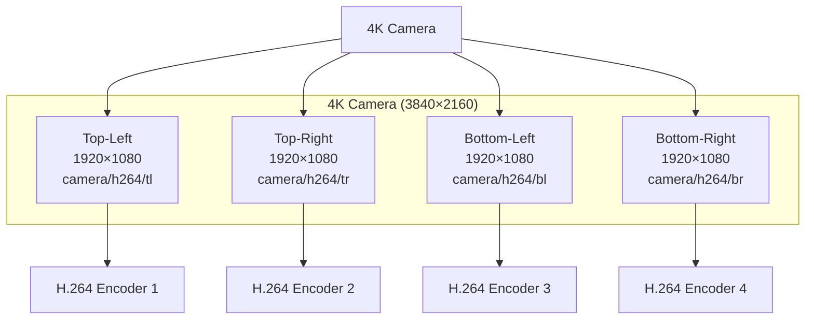

# EdgeFirst Camera Node

**Production-ready ROS2-compatible camera publisher with zero-copy DMA, hardware-accelerated encoding, and EdgeFirst Perception integration**

[](LICENSE)
[](https://www.rust-lang.org/)
[]()

---

## Overview

The EdgeFirst Camera Node is a high-performance camera service designed for edge AI perception systems. It captures through the EdgeFirst Camera SDK (`crates/camera`, V4L2 on Linux), provides zero-copy DMA buffer access for ultra-low latency pipelines, and publishes ROS2-compatible messages over Zenoh for seamless integration with robotics and vision ecosystems.

**Key Features:**

- 🎥 **ROS2 Compatibility** - Standard `sensor_msgs` interfaces for drop-in integration
- ⚡ **Zero-Copy DMA** - Direct memory access for latency-critical vision pipelines
- 🚀 **Hardware Acceleration** - Image conversion and scaling through the EdgeFirst HAL, and V4L2 hardware H.264 encoding
- 📦 **Multi-Format Output** - Raw DMA, JPEG, and H.264 streams from single capture
- 🔧 **Flexible Transport** - Native Zenoh with optional ROS2 bridge compatibility
- 📊 **Production Ready** - Tracy profiling, journald logging, comprehensive error handling
- 🎬 **4K Support** - Automatic tiling for high-resolution cameras
- 💾 **Record and Replay** - Record the H.264 stream with a JSON sidecar and replay it through the same pipeline

---

## EdgeFirst Perception Ecosystem

The EdgeFirst Camera Node is the **sensor interface layer** of the EdgeFirst Perception Middleware—a modular software stack for edge AI vision systems.

### Architecture Context



**What the Camera Node Does:**

- **Captures** frames from hardware cameras (MIPI CSI-2, USB UVC), or replays a recording
- **Processes** frames with hardware-accelerated format conversion and scaling
- **Encodes** video streams (JPEG for visualization, H.264 for recording)
- **Publishes** to Zenoh topics using ROS2 message formats
- **Provides** zero-copy DMA access for low-latency vision model inference

**Integration Points:**

- **Vision Models**: Consume raw DMA buffers for real-time object detection, classification, segmentation
- **Fusion Models**: Combine camera data with radar/LiDAR for multi-modal perception
- **Recording**: The node records its own H.264 stream as raw Annex-B with a JSON sidecar, and replays it (see [Recording and Replay](#recording-and-replay))
- **Web UI**: Live JPEG/H.264 streaming for monitoring and debugging
- **Custom Applications**: ROS2-compatible message access via zenoh-bridge-dds

**Learn More:** [EdgeFirst Perception Documentation](https://doc.edgefirst.ai/test/perception/)

---

## Quick Start

### Prerequisites

**Hardware:**

- NXP i.MX8M Plus based platform (Maivin, Raivin) or compatible ARM64 device
- Camera: MIPI CSI-2 or USB UVC camera
- Minimum: 2GB RAM, quad-core ARM Cortex-A53

**Software:**

- Linux kernel 5.10+ with V4L2 support
- Rust 1.94 or later (for building from source)
- OR: Pre-built binaries from [GitHub Releases](https://github.com/EdgeFirstAI/camera/releases)

### Installation

**Option 1: Pre-built Binary (Recommended)**

```bash
# Download latest release for ARM64
wget https://github.com/EdgeFirstAI/camera/releases/latest/download/edgefirst-camera-linux-aarch64

# Make executable
chmod +x edgefirst-camera-linux-aarch64

# Run with default settings
./edgefirst-camera-linux-aarch64 --jpeg --h264
```

**Option 2: Build from Source**

```bash
# Clone repository
git clone https://github.com/EdgeFirstAI/camera.git
cd camera

# Build release binary
cargo build --release

# Run
./target/release/edgefirst-camera --jpeg --h264
```

**Option 3: Cross-Compile for ARM64**

```bash
# Add ARM64 target
rustup target add aarch64-unknown-linux-gnu

# Install cross-compilation toolchain
# (Debian/Ubuntu)
sudo apt-get install gcc-aarch64-linux-gnu

# Build for ARM64
cargo build --release --target aarch64-unknown-linux-gnu

# Binary at: target/aarch64-unknown-linux-gnu/release/edgefirst-camera
```

### Basic Usage

**Single Camera with JPEG and H.264 Streams:**

```bash
edgefirst-camera \
  --camera /dev/video0 \
  --camera-mode 1080p30 \
  --jpeg \
  --h264
```

**4K Camera with Automatic Tiling:**

```bash
# Automatically splits 4K into 4x 1080p H.264 tiles
edgefirst-camera \
  --camera /dev/video0 \
  --camera-size 3840 2160 \
  --h264-tiles
```

**Zero-Copy DMA for Vision Models:**

```bash
# Publishes CameraFrame (embedded Tensor + dma-buf planes) on camera/frame
# Consume these in your vision model for lowest latency
edgefirst-camera --camera /dev/video0
```

**Custom Topics and Configuration:**

```bash
edgefirst-camera \
  --camera /dev/video1 \
  --frame-topic camera/front/frame \
  --jpeg-topic camera/front/jpeg \
  --h264-topic camera/front/h264 \
  --mirror both \
  --stream-size 640 480
```

---

## Key Capabilities

### ROS2 Message Compatibility

The camera node publishes standard ROS2 message types using CDR serialization, ensuring seamless integration with existing ROS2 ecosystems:

| Topic (default) | Message Type | Description |
|----------------|--------------|-------------|
| `camera/frame` | `edgefirst_msgs/CameraFrame` | Zero-copy frame: Header + seq + embedded Tensor (dma-buf planes) |
| `camera/info` | `sensor_msgs/CameraInfo` | Camera calibration and metadata |
| `camera/jpeg` | `sensor_msgs/CompressedImage` | JPEG-compressed frames |
| `camera/h264` | `foxglove_msgs/CompressedVideo` | H.264 video stream |
| `camera/h264/tl` | `foxglove_msgs/CompressedVideo` | 4K tile: top-left (1080p) |
| `camera/h264/tr` | `foxglove_msgs/CompressedVideo` | 4K tile: top-right (1080p) |
| `camera/h264/bl` | `foxglove_msgs/CompressedVideo` | 4K tile: bottom-left (1080p) |
| `camera/h264/br` | `foxglove_msgs/CompressedVideo` | 4K tile: bottom-right (1080p) |
| `tf_static` | `geometry_msgs/TransformStamped` | Camera frame transform |

In live capture, every frame-tied topic (`camera/frame`, `camera/info`, `camera/jpeg`, `camera/h264` and the tiles) is stamped with the frame's acquisition time: the V4L2 capture timestamp converted to `CLOCK_REALTIME`. The Zenoh sample timestamp carries the same instant. Stamps follow wall-clock steps (for example NTP or GNSS sync after boot) without a service restart. `tf_static` is stamped at each 1 Hz republish. When replaying a `file:` source there is no acquisition time: each frame is stamped with `CLOCK_REALTIME` when it is delivered for playback, so the original recording times are not preserved. See [ARCHITECTURE.md](ARCHITECTURE.md#timestamps).

**ROS2 Bridge Integration:**

```bash
# Start camera node
edgefirst-camera --jpeg --h264 &

# Start zenoh-bridge-dds for ROS2 compatibility
zenoh-bridge-dds

# View with ROS2 tools
ros2 topic list
ros2 topic echo /camera/info
rqt_image_view  # View JPEG stream
```

### Zero-Copy DMA Architecture

For latency-critical vision pipelines, the camera node provides direct DMA buffer access:

```rust
// Vision model consuming CameraFrame tensors (pseudo-code)
subscriber.on_message(|payload| {
    let cf = CameraFrame::from_cdr(payload)?;
    let t = cf.tensor();
    let plane = t.plane_at(0)?;
    // t.pid() + plane.handle: dma-buf fd in the producer
    // t.shape(): [h, w] for NV12, [h, w, 2] for YUYV; t.format(): HAL name, "YUYV" / "NV12" / ...
    // NV12 frames carry two planes: Y, then interleaved UV
    // plane.offset / stride / size / used: memory layout

    let local_fd = pidfd_getfd(t.pid(), plane.handle as RawFd)?;
    let frame = map_dma_buffer(local_fd, plane.offset, plane.size)?;
    model.infer(frame)?;
});
```

**Performance Benefits:**

- **5-10ms latency** vs 50-100ms with traditional copy-based approaches
- **Zero memory copies** from camera to inference
- **Reduced CPU load** - no memcpy overhead
- **Lower memory bandwidth** - critical for edge devices

### Hardware Acceleration

**Image Conversion (EdgeFirst HAL `edgefirst-image`):**

- The HAL's `ImageProcessor` picks OpenGL, then G2D, then CPU, whichever the platform offers
- Format conversion: to RGBA for JPEG, and to YUYV (or RGBA) for H.264 only when the encoder does not take the capture format at the stream size
- Scaling from the capture size to `--stream-size`
- Mirroring, when the camera cannot mirror itself

**H.264 Hardware Encoder (EdgeFirst HAL `edgefirst-codec`):**

- V4L2 memory-to-memory encoder (vsi_v4l2 on i.MX 8M Plus), up to 1920×1080 per stream
- Configurable bitrate (5/25/50/100 Mbps)
- Automatic tiling for resolutions > 1080p
- Tile-specific FPS control to reduce artifacts

**JPEG:** software encoding with libjpeg-turbo (`turbojpeg`); the i.MX 8M Plus has no hardware JPEG encoder.

### 4K Tiling for High-Resolution Cameras

For cameras with resolutions exceeding 1080p, the camera node automatically splits frames into 1920×1080 tiles for hardware encoding:



**Why Tiling?**

- **Hardware Limitation**: NXP H.264 encoder max resolution is 1920×1080
- **Parallel Processing**: 4 encoder instances for higher throughput
- **Artifact Reduction**: Lower FPS per tile reduces compression artifacts at 4K

---

## Configuration

### Command-Line Options

```bash
edgefirst-camera --help
```

**Essential Options:**

- `--source <SOURCE>` - Frame source: a V4L2 device path (`/dev/video3`), `file:<name>.h264` for a recording with its `<name>.json` sidecar, or `mock[:WxH@fps]` for synthetic frames. Unset uses `--camera`.
- `--camera <PATH>` - Camera device path, used when `--source` is unset (default: `/dev/video3`)
- `--memory <auto|import|export>` - Capture buffer allocation: `import` this service's contiguous buffers, `export` the driver's own, or `auto` to import and fall back to the driver's buffers when it refuses them (default: `auto`)
- `--camera-size <WIDTH> <HEIGHT>` - Requested capture resolution. Unset keeps the camera's current size.
- `--camera-fps <FPS>` - Requested capture rate. Unset keeps the camera's current rate. For a `file:` source, the playback rate (default: the recording's).
- `--camera-mode <MODE>` - Shorthand for `--camera-size` plus `--camera-fps`: a size name (`VGA`, `WVGA`, `540p`, `720p`, `1080p`, `4K`) followed by the rate, for example `1080p30`. Accepted only when the camera reports that mode; otherwise startup fails and lists the modes the camera offers. Explicit `--camera-size` and `--camera-fps` win over it with a warning. The rate-only form (`30FPS`) is no longer accepted; use `--camera-fps`. Not accepted for `file:` or `mock` sources.
- `--stream-size <WIDTH> <HEIGHT>` - Output resolution for JPEG/H264 (default: `1920 1080`)
- `--mirror <none|horizontal|vertical|both>` - Flip the image into its natural orientation (default: `both`). See [Camera Orientation](#camera-orientation).

**Camera Controls:**

- `--exposure <auto|MICROSECONDS>` - Exposure: `auto`, or a fixed exposure time in microseconds
- `--gain <auto|MULTIPLIER>` - Analogue gain: `auto`, or a fixed gain multiplier
- `--white-balance <auto|KELVIN>` - White balance: `auto`, or a fixed colour temperature in kelvin

Unset controls keep the camera's setting. A camera that does not offer a control logs a warning.

**Output Formats:**

- `--jpeg` - Enable JPEG streaming
- `--h264` - Enable H.264 streaming
- `--h264-tiles` - Enable 4K tiling (auto-enabled for >1080p cameras)

**Topic Configuration:**

- `--frame-topic <TOPIC>` - CameraFrame topic (default: `camera/frame`)
- `--info-topic <TOPIC>` - CameraInfo topic (default: `camera/info`)
- `--jpeg-topic <TOPIC>` - JPEG topic (default: `camera/jpeg`)
- `--h264-topic <TOPIC>` - H264 topic (default: `camera/h264`)

**Performance Tuning:**

- `--h264-bitrate <auto|mbps5|mbps25|mbps50|mbps100>` - H264 bitrate (default: `auto`)
- `--h264-tiles-fps <FPS>` - FPS limit for 4K tiles (default: `15`)
- `--camera-buffers <N>` - Capture buffers, 2–32 (default: `4`). Subscribers of `--frame-topic` must read each frame within about `N - 1` frame periods before the camera overwrites its DMA buffer: 100 ms with 4 buffers at 30 FPS, 50 ms at 60 FPS. Each buffer costs one capture frame of CMA memory. The service adds two buffers of its own while H.264, tiles or JPEG is on, for frames waiting for its encoders.

**Recording and Replay:**

- `--record <PATH>` - Record the live H.264 stream to `<PATH>` as raw Annex-B. Writes a `<name>.json` sidecar alongside. Requires `--h264` and a camera source.
- `--source file:<PATH>` - Replay a recording instead of opening a camera. Requires the matching `.json` sidecar. `--replay <PATH>` is a deprecated alias that logs a warning.
- `--replay-loop` - Loop a `file:` source back to the start at its end. `CameraFrame.seq` keeps incrementing across loops.
- `--replay-fps <N>` - Playback rate of a `file:` source; an alias of `--camera-fps`, which wins when both are set (default: the sidecar's recorded rate).

**Zenoh Configuration:**

- `--mode <peer|client|router>` - Zenoh participant mode (default: `peer`)
- `--connect <ENDPOINT>` - Connect to Zenoh router
- `--listen <ENDPOINT>` - Listen for Zenoh connections
- `--no-multicast-scouting` - Disable Zenoh multicast peer discovery

**Debugging:**

- `--tracy` - Enable Tracy profiler integration
- `--tokio-console` - Enable Tokio console for async debugging

**See full options:** `edgefirst-camera --help`

### Camera Orientation

`MIRROR` exists only to publish the image in its natural orientation, upright as a person would view the scene. It undoes how the sensor is mounted: Maivin and Raivin mount the camera upside down, so the default `both` (a horizontal plus vertical flip, which is a 180° rotation) makes the output upright.

Mirroring is requested from the camera. When the camera cannot mirror (the control is unsupported or fails), the service logs a warning, mirrors the JPEG and H.264 outputs in its encoders, and publishes `camera/frame` unmirrored.

Downstream applications, including fusion, assume the published image is in its natural orientation:

- `CAM_TF_VEC` / `CAM_TF_QUAT` and the calibration from `CAM_INFO_PATH` describe the natural image. They are for calibration and must not encode the mount rotation that `MIRROR` already removes.
- Mirroring for presentation or demos is a view option in the WebUI, not a camera setting.

### Environment Variables

All command-line flags can be set using the direct environment-variable
names shown by `--help` and in `camera.default`:

```bash
export CAMERA=/dev/video0
export CAMERA_MODE=1080p30
export MIRROR=both
export JPEG=true
export H264=true

edgefirst-camera  # Uses environment configuration
```

### Zenoh Networking

The Zenoh session is configured with `MODE`, `CONNECT`, `LISTEN` and `NO_MULTICAST_SCOUTING`; there is no Zenoh configuration file option. For example, to connect to a router without multicast discovery:

```bash
edgefirst-camera --mode client --connect tcp/192.168.1.100:7447 --no-multicast-scouting
```

---

## Recording and Replay

The camera node ships built-in recording and replay of the H.264 stream, intended for reproducible tests and demos. Recordings are plain raw Annex-B bitstream files — power-loss resilient, playable in VLC / mpv / ffplay out of the box.

### Recording

```bash
# Record H.264 to a file (requires --h264 and a camera source).
edgefirst-camera --camera /dev/video0 --h264 --record capture.h264
```

Writes two files:

- `capture.h264` — raw H.264 Annex-B bitstream, appended frame-by-frame. Flushed on every keyframe so a crash loses at most one GOP (~1 s).
- `capture.json` — sidecar metadata. Written **once at startup**, holds colorimetry + the exact `sensor_msgs/CameraInfo` and `/tf_static` payloads that would have been published live. Stateless; no per-frame data.

The tap is inside the h264 encode thread and runs **before** the Zenoh publish, so the recorder captures every frame even if Zenoh drops a publish under congestion.

### Replaying

```bash
# Replay the recorded pair — camera device is not opened.
edgefirst-camera --source file:capture.h264

# Loop indefinitely; seq keeps incrementing across loop boundaries.
edgefirst-camera --source file:capture.h264 --replay-loop

# Override playback rate.
edgefirst-camera --source file:capture.h264 --camera-fps 15

# JPEG works on replay too.
edgefirst-camera --source file:capture.h264 --jpeg
```

The recording is decoded with the platform's V4L2 H.264 decoder, so replay needs Linux with a hardware decoder (for example the i.MX 8M Plus). `--replay <PATH>` still works as a deprecated alias for `--source file:<PATH>` and logs a warning.

Replay publishes on the same topics and schemas as live capture — subscribers see identical on-wire data. `/camera/info`, `/tf_static`, and the CameraFrame tensor colorimetry fields come from the sidecar; the recording's values win over `--cam-info-path`, `--cam-tf-vec`, `--cam-tf-quat` and `--base-frame-id`.

The `camera/h264` topic forwards the recorded Annex-B bytes **verbatim** — no re-encode. `camera/frame` publishes the decoded NV12 frames, and `--jpeg` compresses them.

`--mirror` and `--stream-size` do not apply to a `file:` source: the recording was mirrored when it was made, and every output keeps the recording's size. H.264 tiles are encoded from the decoded frames, so, as with live capture, they apply only to recordings larger than 1080p.

The sidecar format (version 1) is unchanged from 2.x, so 2.x recordings replay.

### Playback outside the camera service

The raw `.h264` file is directly playable by any standard tool:

```bash
vlc capture.h264
mpv --demuxer=h264 capture.h264
ffplay -f h264 -framerate 30 capture.h264
ffmpeg -i capture.h264 -c copy capture.mp4   # remux to MP4, no re-encode
```

See [ARCHITECTURE.md § Record and Replay](ARCHITECTURE.md#record-and-replay) for the sidecar JSON schema and internals.

---

## Profiling

The camera node includes Tracy profiler integration for performance analysis. See [CONTRIBUTING.md](CONTRIBUTING.md#profiling-and-performance-analysis) for setup instructions.

**Quick Start:**

```bash
# Run with Tracy profiler enabled
edgefirst-camera --tracy --camera /dev/video0 --jpeg --h264

# Connect Tracy profiler GUI to analyze frame timing
# Download Tracy: https://github.com/wolfpld/tracy/releases
```

---

## Platform Support

### Tested Platforms

| Platform | Architecture | Status | Notes |
|----------|--------------|--------|-------|
| Maivin + Raivin | ARM64 (i.MX8M Plus) | ✅ Fully Supported | Primary target, all features |
| NXP i.MX8M Plus EVK | ARM64 | ✅ Supported | Hardware acceleration available |
| Generic ARM64 Linux | ARM64 | ⚠️ Partial | Conversion falls back to OpenGL or CPU; H.264 and replay need a V4L2 hardware encoder and decoder |
| x86_64 Linux | x86_64 | ⚠️ Development Only | Usually no V4L2 H.264 encoder; use `--h264 false` or the `mock` source |
| macOS, Windows | x86_64, ARM64 | ⚠️ Development Only | Runs on the `mock` source only, with `--h264 false`: no camera backend or H.264 encoder yet |

### Camera Compatibility

**MIPI CSI-2 Cameras** (primary):

- Directly connected via CSI interface
- Lowest latency, highest performance
- V4L2 device typically `/dev/video0-3`

**USB UVC Cameras** (secondary):

- Standard USB webcams
- V4L2 device typically `/dev/video4+`
- Slightly higher latency

**Supported Formats:**

- YUYV (preferred for hardware acceleration)
- NV12, RGB, RGBA

---

## Development

### Building from Source

```bash
# Clone repository
git clone https://github.com/EdgeFirstAI/camera.git
cd camera

# Build with all features
cargo build --release

# Run tests (application and SDK)
cargo test --workspace

# Run the SDK capture benchmarks (requires a V4L2 camera)
cargo bench -p edgefirst-camera --bench capture

# Generate documentation
cargo doc --no-deps --open
```

### Project Structure

```text
camera/
├── src/                 # edgefirst-camera application (binary only)
│   ├── main.rs          # Startup, logging, Zenoh session
│   ├── args.rs          # CLI arguments and environment variables
│   ├── source.rs        # Opening the source, ISP-not-ready retry, capture pool, mirroring
│   ├── pipeline.rs      # Capture loop, publishers, encoder threads, drop reports, tf_static
│   ├── encode.rs        # H.264 main stream and 4K tiles
│   ├── jpeg.rs          # JPEG compression
│   └── messages.rs      # camera/info, tf_static, compressed payloads, Zenoh timestamps
├── crates/camera/       # edgefirst-camera SDK (V4L2, file and mock sources)
├── tests/               # Application integration tests (env_scrub.rs, on_target.rs)
├── camera.default       # systemd EnvironmentFile reference
├── Cargo.toml           # Workspace and application manifest
└── README.md            # This file
```

**See also:**

- [ARCHITECTURE.md](ARCHITECTURE.md) - Detailed architecture and design decisions
- [CONTRIBUTING.md](CONTRIBUTING.md) - Contribution guidelines and development workflow
- [SECURITY.md](SECURITY.md) - Security policy and vulnerability reporting

---

## Troubleshooting

### Common Issues

**Problem: "No such device" error**

```bash
# List available cameras
v4l2-ctl --list-devices

# Try different device path
edgefirst-camera --camera /dev/video0
```

**Problem: "Permission denied" accessing camera**

```bash
# Add user to video group
sudo usermod -a -G video $USER
# Log out and back in for changes to take effect

# Or run with elevated permissions (not recommended for production)
sudo edgefirst-camera
```

**Problem: Low FPS or frame drops**

```bash
# Check CPU usage
htop

# Reduce output formats to decrease load
edgefirst-camera --jpeg  # Only JPEG, no H264

# For 4K cameras, ensure tiling is enabled
edgefirst-camera --camera-size 3840 2160 --h264-tiles
```

**Problem: JPEG/H264 streams not appearing in ROS2**

```bash
# Ensure zenoh-bridge-dds is running
zenoh-bridge-dds &

# Check Zenoh can see publishers
zenoh-cli query "**"

# Verify ROS2 topics
ros2 topic list | grep camera
```

**Problem: DMA buffers not working with custom application**

- Ensure your application has access to DMA heap (`/dev/dma_heap/linux,cma`)
- File descriptor passing requires Unix domain sockets or shared memory
- Check your Zenoh session configuration allows large payloads

### Logging

```bash
# Set log level
RUST_LOG=debug edgefirst-camera

# Filter specific module
RUST_LOG=edgefirst_camera::pipeline=trace edgefirst-camera

# View systemd journal logs
journalctl -u edgefirst-camera -f
```

---

## License

This project is licensed under the Apache License 2.0 - see the [LICENSE](LICENSE) file for details.

**Third-Party Components:** See [NOTICE](NOTICE) for required attributions.

---

## Contributing

We welcome contributions! Please see [CONTRIBUTING.md](CONTRIBUTING.md) for:

- Code style guidelines
- Development workflow
- Pull request process
- Testing requirements

**Found a bug?** [Open an issue](https://github.com/EdgeFirstAI/camera/issues)

**Have a feature request?** [Start a discussion](https://github.com/orgs/EdgeFirstAI/discussions)

---

## Support

**Community Resources:**

- 📚 **Documentation**: https://doc.edgefirst.ai/test/perception/
- 💬 **Discussions**: https://github.com/orgs/EdgeFirstAI/discussions
- 🐛 **Issues**: https://github.com/EdgeFirstAI/camera/issues

**Commercial Support:**

- **EdgeFirst Studio**: Integrated deployment, monitoring, and management
- **Professional Services**: Training, custom development, enterprise support
- **Contact**: support@au-zone.com

---

## Acknowledgments

Built with ❤️ by the EdgeFirst team at [Au-Zone Technologies](https://au-zone.com)

For questions or support, see our [Contributing Guide](CONTRIBUTING.md) or open an issue on [GitHub](https://github.com/EdgeFirstAI/camera/issues).

**Powered by:**

- [Zenoh](https://zenoh.io/) - Efficient pub/sub middleware
- [Tokio](https://tokio.rs/) - Async runtime
- [ROS2 CDR](https://design.ros2.org/) - Message serialization
- [NXP i.MX8](https://www.nxp.com/products/processors-and-microcontrollers/arm-processors/i-mx-applications-processors/i-mx-8-applications-processors:IMX8-SERIES) - Hardware acceleration platform


