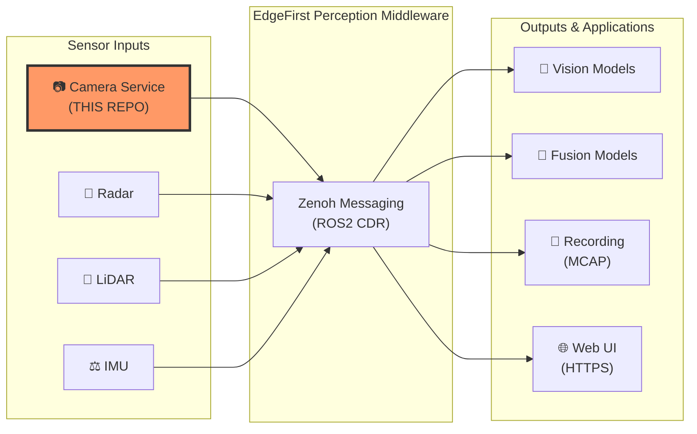
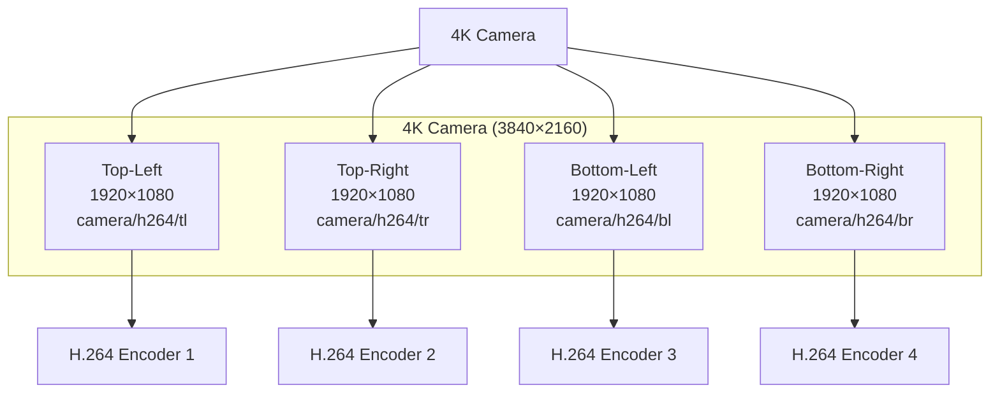

# EdgeFirst Camera Node

**Production-ready ROS2-compatible camera publisher with zero-copy DMA, hardware-accelerated encoding, and EdgeFirst Perception integration**

[](LICENSE)
[](https://www.rust-lang.org/)
[](#platform-support)

---

## Overview

The EdgeFirst Camera Node is a high-performance camera service designed for edge AI perception systems. It captures through the EdgeFirst Camera SDK (`crates/camera`) from V4L2 and libcamera cameras on Linux, recorded files and a synthetic source, provides zero-copy DMA buffer access for ultra-low latency pipelines, and publishes ROS2-compatible messages over Zenoh for seamless integration with robotics and vision ecosystems.

**Key Features:**

- 🎥 **ROS2 Compatibility** - Standard `sensor_msgs` interfaces for drop-in integration
- ⚡ **Zero-Copy DMA** - Direct memory access for latency-critical vision pipelines
- 🚀 **Hardware Acceleration** - Image conversion and scaling through the EdgeFirst HAL, and V4L2 hardware H.264 encoding
- 📦 **Multi-Format Output** - Raw DMA, JPEG, and H.264 streams from single capture
- 🔧 **Flexible Transport** - Native Zenoh with optional ROS2 bridge compatibility
- 📊 **Production Ready** - Tracy profiling, journald logging, comprehensive error handling
- 🎬 **4K Support** - Automatic tiling for high-resolution cameras
- 💾 **Record and Replay** - Record the H.264 stream with a JSON sidecar and replay it through the same pipeline

---

## EdgeFirst Perception Ecosystem

The EdgeFirst Camera Node is the **sensor interface layer** of the EdgeFirst Perception Middleware—a modular software stack for edge AI vision systems.

### Architecture Context



**What the Camera Node Does:**

- **Captures** frames from hardware cameras (MIPI CSI-2, USB UVC) through V4L2 or libcamera, or replays a recording
- **Processes** frames with hardware-accelerated format conversion and scaling
- **Encodes** video streams (JPEG for visualization, H.264 for recording)
- **Publishes** to Zenoh topics using ROS2 message formats
- **Provides** zero-copy DMA access for low-latency vision model inference

**Integration Points:**

- **Vision Models**: Consume raw DMA buffers for real-time object detection, classification, segmentation
- **Fusion Models**: Combine camera data with radar/LiDAR for multi-modal perception
- **Recording**: The node records its own H.264 stream as raw Annex-B with a JSON sidecar, and replays it (see [Recording and Replay](#recording-and-replay))
- **Web UI**: Live JPEG/H.264 streaming for monitoring and debugging
- **Custom Applications**: ROS2-compatible message access via zenoh-bridge-dds

**Learn More:** [EdgeFirst Perception Documentation](https://doc.edgefirst.ai/test/perception/)

---

## Quick Start

### Prerequisites

**Hardware:**

- NXP i.MX8M Plus based platform (Maivin, Raivin), an i.MX 95 or a Raspberry Pi 5, or another ARM64 device (see [Platform Support](#platform-support))
- Camera: MIPI CSI-2 or USB UVC camera
- Minimum: 2GB RAM, quad-core ARM Cortex-A53

**Software:**

- Linux kernel 5.10+ with V4L2 support (libcamera 0.5 or newer for `libcamera:` cameras)
- Rust 1.94 or later (for building from source)
- OR: Pre-built binaries from [GitHub Releases](https://github.com/EdgeFirstAI/camera/releases)

### Installation

**Option 1: Pre-built Binary (Recommended)**

```bash
# Download latest release for ARM64
wget https://github.com/EdgeFirstAI/camera/releases/latest/download/edgefirst-camera-linux-aarch64

# Make executable
chmod +x edgefirst-camera-linux-aarch64

# Run with H.264 (or --jpeg on a board without an H.264 encoder)
./edgefirst-camera-linux-aarch64 --h264
```

**Option 2: Build from Source**

```bash
# Clone repository
git clone https://github.com/EdgeFirstAI/camera.git
cd camera

# Build release binary
cargo build --release

# Run
./target/release/edgefirst-camera --h264
```

**Option 3: Cross-Compile for ARM64**

```bash
# Add ARM64 target
rustup target add aarch64-unknown-linux-gnu

# Install the cross-compilation tools
cargo install cargo-zigbuild
pip install ziglang   # or install Zig from https://ziglang.org/download/

# Build for ARM64 against glibc 2.35, the floor for board binaries
cargo zigbuild --release --target aarch64-unknown-linux-gnu.2.35

# Binary at: target/aarch64-unknown-linux-gnu/release/edgefirst-camera
```

### Basic Usage

**Single Camera with an H.264 Stream:**

```bash
edgefirst-camera \
  --camera /dev/video0 \
  --camera-mode 1080p30 \
  --h264
```

Use `--jpeg` instead of `--h264` on a board without an H.264 encoder; see [Choosing JPEG or H.264](#choosing-jpeg-or-h264).

**4K Camera with Automatic Tiling:**

```bash
# Splits 4K into 4x 1080p H.264 tiles. With --h264, tiles also turn on by
# themselves for live capture above 1080p.
edgefirst-camera \
  --camera /dev/video0 \
  --camera-size 3840 2160 \
  --h264-tiles
```

**Zero-Copy DMA for Vision Models:**

```bash
# Publishes CameraFrame (embedded Tensor + dma-buf planes) on camera/frame
# Consume these in your vision model for lowest latency
edgefirst-camera --camera /dev/video0
```

**Custom Topics and Configuration:**

```bash
edgefirst-camera \
  --camera /dev/video1 \
  --frame-topic camera/front/frame \
  --jpeg-topic camera/front/jpeg \
  --h264-topic camera/front/h264 \
  --mirror both \
  --stream-size 640 480
```

### Backends and how they're selected

`--source` (`SOURCE`) picks the backend from the form of its value. Unset, the service opens the V4L2 device in `--camera`.

| Source | Backend | Boards and notes |
|---|---|---|
| `/dev/videoN` | V4L2 | Maivin and Raivin (i.MX 8M Plus, `vvcam` ISP, camera on `/dev/video3`), the i.MX 8M Plus EVK and USB UVC cameras. Imports buffers the SDK allocates in contiguous (CMA) memory, from the system DMA-BUF heap on a machine with no CMA heap, or exports the driver's |
| `libcamera:<id>` | libcamera 0.5 or newer | i.MX 95 through the `nxp/neo` pipeline, and Raspberry Pi 5 (`pisp`). Uses libcamera's own buffers. Loaded at run time, so a unit without libcamera runs the other backends as before |
| `file:<name>.h264` | Recording replay | A recording with its `<name>.json` sidecar, decoded by a V4L2 H.264 decoder. Linux boards with a hardware decoder |
| `mock[:WxH@fps]` | Synthetic frames | Testing without a camera. The only backend on macOS and Windows |

Run `edgefirst-camera devices` to list the cameras the service can open, with their `libcamera:<id>` ids, formats, sizes, rates and named modes. `edgefirst-camera info` also reports whether an H.264 encoder and decoder are available.

**Formats.** The service asks V4L2 cameras for YUYV, which the encoders take directly, and captures a camera that lacks it in its current format. Each backend delivers the formats below; anything else is `UnsupportedFormat`.

| Backend | Formats |
|---|---|
| V4L2 | YUYV, VYUY, NV12 (single-buffer or `NV12M`), NV16 (single-buffer or `NV16M`), NV24, GREY, RGB24, RGBA and BGRA |
| libcamera | NV12, NV16, YUYV, VYUY, GREY, RGB, RGBA and BGRA. The service captures NV12. The RPi 5 `pisp` pipeline lists VYUY but aborts when asked to validate it, so it is never requested |
| `file:` | NV12, as decoded |
| `mock` | YUYV (default), NV12, RGBA and GREY |

**i.MX 95.** libcamera's raw-only `imx8-isi` pipeline claims the camera unless libcamera is told to use `nxp/neo`. Set `LIBCAMERA_PIPELINES_MATCH_LIST=nxp/neo` in the environment on the i.MX 95 only: libcamera reads it directly, it is not a flag, and on other platforms it hides the camera.

**Raspberry Pi 5.** The sensor is mounted upright, so set `MIRROR=none`.

### Pinning devices

The H.264 encoder is a V4L2 memory-to-memory node. Without help, the HAL opens every `/dev/video*` node to find one. On a board with fixed devices, name both the camera and the encoder so the service opens nothing else:

```bash
CAMERA=/dev/video3
EDGEFIRST_CODEC_V4L2_ENCODER=/dev/video0
```

These are the Maivin's devices (camera `/dev/video3`, encoder `/dev/video0`), and the Maivin's meta layer sets both in `camera.service`. `EDGEFIRST_CODEC_V4L2_ENCODER` is read by the HAL, not by this program, so it has no flag and is not in `--help`.

---

## Upgrading from 2.12

3.0 is a major release that replaces the capture and encoding stack. The binary (`edgefirst-camera`), the systemd service, the environment file (`/etc/default/camera`), every 2.12 flag and environment variable, and the Zenoh topics and their message types are unchanged, apart from the differences below. Most units upgrade by replacing the binary. Read on if you consume `camera/frame`, use `CAMERA_MODE`, replay recordings, set `RestartPreventExitStatus=` in a unit, or run on anything other than a Maivin.

### What stays the same

- Every 2.12 flag and environment variable still exists with the same name and default. None was removed.
- Topics, message types and `frame_id` values are unchanged, including the tile suffixes (`topleft`, `topright`, `bottomleft`, `bottomright`) and the 1 Hz `tf_static`.
- H.264 streams keep the 2.12 settings: constant bitrate, a key frame every second with SPS and PPS in band, High profile.
- Stamps are acquisition times from `CLOCK_REALTIME`, and the Zenoh sample timestamp carries the same instant.

### Changes that affect consumers

| Change | Effect | Action |
|---|---|---|
| `camera/frame` NV12 frames carry two planes (Y, then interleaved UV) | A consumer that reads only plane 0 sees luma only | Read each plane from `planes`, or keep using plane 0 for luma |
| `camera/frame` YUYV tensors have shape `[H, W, 2]` | 2.12 published `[H, W]`. A packed format's shape ends in its elements per pixel | Read the shape from the message and do not hard-code it |
| `camera/frame` `format` uses the HAL names (`YUYV`, `NV12`, `rgba8`, ...) | Strings that matched 2.12 names may differ | Compare against the names `edgefirst-tensor` defines |
| `camera/frame` is not mirrored when the camera cannot mirror | The JPEG and H.264 outputs are mirrored in software instead, and the service logs a warning | Use a camera or pipeline that mirrors, or apply the flip in the consumer |
| Consumers need `pidfd_getfd` permission | See [Reading Camera Frames](#reading-camera-frames) | Run as the camera service's user or grant `CAP_SYS_PTRACE`, and check `kernel.yama.ptrace_scope` |

### Changes to `CAMERA_MODE`, `CAMERA_SIZE` and `CAMERA_FPS`

| 2.12 | 3.0 |
|---|---|
| `CAMERA_MODE=30FPS` (rate only) | Accepted as a deprecated alias for `CAMERA_FPS=30`, with a warning |
| `CAMERA_MODE=1080p30` overrides `CAMERA_SIZE` | Shorthand for `CAMERA_SIZE` plus `CAMERA_FPS`. An explicit `CAMERA_SIZE` or `CAMERA_FPS` wins, with a warning |
| Any size and rate is accepted | A named mode is accepted only when the camera reports it. Otherwise the service exits with status 2 and lists the modes the camera offers. Run `edgefirst-camera devices` to see them |
| Unset keeps the live size and rate | Unchanged |
| Size and rate are applied or fail | Size and rate are requests. The service logs what the camera applied, and the delivered rate is measured |
| A named mode is accepted for file replay | Error: file and mock sources cannot report modes. Use `CAMERA_FPS` |

### Changes to replay and recording

- `SOURCE=file:<name>.h264` replaces `REPLAY=<name>.h264`. `REPLAY` and `--replay` still work as a deprecated alias and log a warning. `REPLAY_FPS` is an alias of `CAMERA_FPS`, which wins when both are set.
- `JPEG` and `H264_TILES` now work with a replayed recording. 2.12 refused them.
- Replay still needs a V4L2 H.264 decoder. `MIRROR` and `STREAM_SIZE` do not apply to a `file:` source.
- `RECORD` needs `H264` and a camera source, as before.

### New variables and flags

| Variable | Flag | Purpose |
|---|---|---|
| `SOURCE` | `--source` | Frame source: `/dev/videoN`, `libcamera:<id>`, `file:<name>.h264` or `mock[:WxH@fps]`. Empty uses `CAMERA` |
| `MEMORY` | `--memory` | Capture buffer allocation: `auto` (default), `import` or `export` |
| `CAMERA_FPS` | `--camera-fps` | Requested capture rate, or the playback rate of a `file:` source |
| `EXPOSURE`, `GAIN`, `WHITE_BALANCE` | `--exposure`, `--gain`, `--white-balance` | `auto` or a fixed value (microseconds, multiplier, kelvin). A camera without the control logs a warning |
| `H264_FPS` | `--h264-fps` | Rate the H.264 encoder is set up for: `auto` (default), `measure` or a number |
| `LIBCAMERA_PIPELINES_MATCH_LIST` | none | Read by libcamera. Set it to `nxp/neo` on the i.MX 95 only |
| `EDGEFIRST_CODEC_V4L2_ENCODER` | none | Read by the HAL. Pins the H.264 encoder node; see [Pinning devices](#pinning-devices) |

New subcommands: `devices`, `info`, `record` and `convert`. Without a subcommand the program runs the service as before.

### Behaviour changes

- **Compressed outputs are off by default.** `H264` now defaults to off, as `JPEG` already did, and the shipped `camera.default` leaves both off. 2.12 turned H.264 on unless told otherwise. A unit whose `/etc/default/camera` sets `H264="true"`, as 2.12's file did, is unaffected; one that relied on the built-in default publishes no `camera/h264` until `H264="true"` is set.
- **Memory.** The capture pool is allocated in contiguous (CMA) memory, and the service adds two buffers of its own while `H264`, `H264_TILES` or `JPEG` is on. With the default `CAMERA_BUFFERS=4` a unit uses six capture buffers. `CAMERA_BUFFERS` keeps its meaning for subscribers: they have about `CAMERA_BUFFERS - 1` frame periods to read a frame. If CMA runs out, startup fails with a message that suggests a smaller `CAMERA_BUFFERS`. The capture pool no longer creates a GL context, and in the default H.264-direct configuration GL is never initialised.
- **Camera restart.** A camera that stops after it started, for example when `isp_media_server` restarts, is reopened inside the running service. `seq` continues. The service exits for systemd only when the reopened camera delivers a different stream or nothing.
- **Encoder failure.** If an encoder thread exits or panics, or keeps failing, the service exits with status 70 (see [Exit statuses](#exit-statuses)) so systemd restarts it. It no longer streams on silently without H.264 or JPEG.
- **Exit statuses.** The service exits with statuses that systemd names in the journal; see [Exit statuses](#exit-statuses). Units that match on `SuccessExitStatus=` or `RestartPreventExitStatus=` need reviewing.
- **Readiness and watchdog.** When the unit sets `Type=notify`, the service reports readiness and pings the watchdog; see [Readiness and watchdog](#readiness-and-watchdog). Under `Type=simple` nothing changes.
- **Drop reporting.** The periodic log line reports each output against the frames offered to it, for example `jpeg=127/300`.
- **JPEG queue.** The JPEG stage always compresses the newest frame. A frame that arrives while another waits replaces it, and the replaced frame counts as a drop.
- **Logging.** Under systemd, log lines reach the journal once, through journald, and no longer also as stdout text.
- **Frame rate.** The service logs the rate the camera delivers, frames over time across about a second, once measured and whenever it changes, for example when auto-exposure lengthens frames in dim light. A recording's sidecar is corrected as it goes and ends at the rate at which the frames in the file last as long as the capture did, which keeps the recording's duration if the rate changed along the way or the encoder missed frames.

**Measured on a Maivin at 1080p30:** H.264 p95 latency is 9.7 ms against 11.8 ms on 2.12, and CPU use is 8.8% against 13.1%.

### Platforms

3.0 adds libcamera cameras (`--source libcamera:<id>`, libcamera 0.5 or newer) for the i.MX 95 (`nxp/neo` pipeline) and the Raspberry Pi 5. `MIRROR` defaults to `both` for the Maivin and Raivin mounts. Set `MIRROR=none` on a camera mounted upright, such as a Raspberry Pi 5.

### Build and packaging

- The `videostream` library and the `edgefirst_camera_app` library target are gone. Recipes drop the videostream dependency. Image conversion, scaling and H.264 encoding come from the EdgeFirst HAL.
- The repository is a Cargo workspace. The application package is `edgefirst-camera-app` and the binary is still `edgefirst-camera`. Rust 1.94 or newer builds it.
- Board binaries target glibc 2.35 (`cargo zigbuild --target aarch64-unknown-linux-gnu.2.35`).

### Upgrade and roll back

1. Run `edgefirst-camera devices` on the unit. Confirm that a named `CAMERA_MODE` in `/etc/default/camera` is listed, and that an explicit `CAMERA_SIZE` or `CAMERA_FPS` set beside it is what you want, since it now wins.
2. Review the unit: add `Type=notify`, `WatchdogSec=30` and `RestartPreventExitStatus=2 69` as described in [Running under systemd](#running-under-systemd), and check any `SuccessExitStatus=` against the new statuses.
3. Replace the binary and restart `camera.service`. Check the journal for warnings about the pool, mirroring, or a delivered rate that differs from the reported one.
4. Check that consumers of `camera/frame` still read their frames. Pay attention to NV12 planes, the YUYV shape and `pidfd_getfd` permissions.
5. To roll back, restore the 2.12 binary and the previous unit. 2.12 ignores environment variables it does not define, so the same environment file works with both versions. The exceptions are a `CAMERA_MODE` and `CAMERA_SIZE` set together, where 2.12 lets the mode win, and `Type=notify`, which 2.12 never signals: set it back to `Type=simple`.

---

## Key Capabilities

### ROS2 Message Compatibility

The camera node publishes standard ROS2 message types using CDR serialization, ensuring seamless integration with existing ROS2 ecosystems:

| Topic (default) | Message Type | Description |
|----------------|--------------|-------------|
| `camera/frame` | `edgefirst_msgs/CameraFrame` | Zero-copy frame: Header + seq + embedded Tensor (dma-buf planes) |
| `camera/info` | `sensor_msgs/CameraInfo` | Camera calibration and metadata |
| `camera/jpeg` | `sensor_msgs/CompressedImage` | JPEG-compressed frames |
| `camera/h264` | `foxglove_msgs/CompressedVideo` | H.264 video stream |
| `camera/h264/tl` | `foxglove_msgs/CompressedVideo` | 4K tile: top-left (1080p) |
| `camera/h264/tr` | `foxglove_msgs/CompressedVideo` | 4K tile: top-right (1080p) |
| `camera/h264/bl` | `foxglove_msgs/CompressedVideo` | 4K tile: bottom-left (1080p) |
| `camera/h264/br` | `foxglove_msgs/CompressedVideo` | 4K tile: bottom-right (1080p) |
| `tf_static` | `geometry_msgs/TransformStamped` | Camera frame transform |

Every frame-tied topic (`camera/frame`, `camera/info`, `camera/jpeg`, `camera/h264` and the tiles) carries the frame's acquisition time as `CLOCK_REALTIME`, and the Zenoh sample timestamp carries the same instant. Stamps follow wall-clock steps (for example NTP or GNSS sync after boot) without a service restart. When replaying a `file:` source there is no acquisition time, so each frame is stamped when it is delivered for playback. See [Timestamps](ARCHITECTURE.md#timestamps) for the clock contract.

**ROS2 Bridge Integration:**

```bash
# Start camera node
edgefirst-camera --jpeg &

# Start zenoh-bridge-dds for ROS2 compatibility
zenoh-bridge-dds

# View with ROS2 tools
ros2 topic list
ros2 topic echo /camera/info
rqt_image_view  # View JPEG stream
```

### Reading Camera Frames

For latency-critical vision pipelines, `camera/frame` carries each frame by reference. The message holds the frame's metadata and a handle to the producer's DMA-BUF, so a consumer on the same machine reads the pixels without a copy:

```rust
// Vision model consuming CameraFrame tensors (pseudo-code)
subscriber.on_message(|payload| {
    let cf = CameraFrame::from_cdr(payload)?;
    let t = cf.tensor();
    let plane = t.plane_at(0)?;
    // t.pid() + plane.handle: dma-buf fd in the producer
    // t.shape(): [h, w] for NV12, [h, w, 2] for YUYV; t.format(): HAL name, "YUYV" / "NV12" / ...
    // NV12 frames carry two planes: Y, then interleaved UV
    // plane.offset / stride / size / used: memory layout

    let local_fd = pidfd_getfd(t.pid(), plane.handle as RawFd)?;
    let frame = map_dma_buffer(local_fd, plane.offset, plane.size)?;
    model.infer(frame)?;
});
```

A consumer:

1. Decodes the `CameraFrame` and reads its tensor.
2. Waits on `fence_fd` when it is non-negative.
3. Opens each plane with `handle >= 0` through `pidfd_getfd` on the producer's `pid`, then `mmap`s it.
4. Reads `[0, used)` of each plane within about `CAMERA_BUFFERS - 1` frame periods, before the camera captures into the buffer again.
5. Unmaps and closes the descriptors it imported.

**Requirements.** `pidfd_getfd` needs the kernel's permission to duplicate a descriptor from another process:

- The consumer runs as the same user as the camera service, or holds `CAP_SYS_PTRACE`.
- `kernel.yama.ptrace_scope` must allow it. At 0 a process of the same user may; at 1 the consumer must be a descendant of the service or hold `CAP_SYS_PTRACE`; at 2 only `CAP_SYS_PTRACE` is enough; at 3 nothing can attach. Check it with `sysctl kernel.yama.ptrace_scope`.
- Frames in process memory (the `mock` source) have no handle another process can open, so their planes travel inline in the message.

**Measured latency.** On a Maivin at 1080p30, `camera/frame` has a p50 of 2.6 ms and a p95 of 3.1 ms. H.264 has a p95 of 9.7 ms, against 11.8 ms on 2.12.

### Hardware Acceleration

**Image Conversion (EdgeFirst HAL `edgefirst-image`):**

- The HAL's `ImageProcessor` picks OpenGL, then G2D, then CPU, whichever the platform offers
- Format conversion: to RGBA for JPEG, and to YUYV (or RGBA) for H.264 only when the encoder does not take the capture format at the stream size
- Scaling from the capture size to `--stream-size`
- Mirroring, when the camera cannot mirror itself

**H.264 Hardware Encoder (EdgeFirst HAL `edgefirst-codec`):**

- V4L2 memory-to-memory encoder (vsi_v4l2 on i.MX 8M Plus), up to 1920×1080 per stream
- Configurable bitrate (5/25/50/100 Mbps); `auto` is about 10 Mbps at 1080p30, High profile
- Automatic tiling for live capture above 1080p with H.264 on
- Tile-specific FPS control to reduce artifacts

**JPEG:** software encoding with libjpeg-turbo (`turbojpeg`) on every platform. The i.MX 8M Plus has no hardware JPEG encoder; the i.MX 95's (`mxc-jpeg`) is not used yet. See [Known Limitations](#known-limitations).

### Choosing JPEG or H.264

The two compressed outputs are alternatives, and both are off by default: enable neither, or the one that suits the platform. A board's BSP usually turns one on in `/etc/default/camera`.

- **JPEG** works on every platform. It is compressed on the CPU, so its rate depends on the stream size and the CPU, and it can fall below the camera's rate.
- **H.264** needs a hardware encoder, which it uses at the camera's rate for little CPU. Without one, the service stops at start with status 69.

The service runs both when asked to, without a warning, but they then share the frames and the CPU, and the board tests check each output on its own.

### 4K Tiling for High-Resolution Cameras

For live capture above 1080p with H.264 on, the camera node automatically splits frames into 1920×1080 tiles for hardware encoding:



With H.264 on, tiles turn on automatically for live capture above 1080p, and off for the `record` subcommand. `--h264-tiles` turns them on for any size.

**Why Tiling?**

- **Hardware Limitation**: NXP H.264 encoder max resolution is 1920×1080
- **Parallel Processing**: 4 encoder instances for higher throughput
- **Artifact Reduction**: Lower FPS per tile reduces compression artifacts at 4K

---

## Configuration

### Command-Line Options and Environment Variables

Every option is also an environment variable, named as in the table, so the same settings work from the shell and from `/etc/default/camera` (see [`camera.default`](camera.default) for a commented reference). A flag on the command line wins over the environment, and an empty variable (`KEY=""`) counts as unset. `edgefirst-camera --help` prints the full text of each option and is the reference this table follows.

**Source and capture**

| Flag | Variable | Default | Description |
|---|---|---|---|
| `--source <SOURCE>` | `SOURCE` | unset | Frame source: `/dev/videoN`, `libcamera:<id>`, `file:<name>.h264` or `mock[:WxH@fps]`. Unset uses `--camera`. See [Backends](#backends-and-how-theyre-selected) |
| `-c, --camera <PATH>` | `CAMERA` | `/dev/video3` | V4L2 device path, used when `--source` is unset |
| `--memory <auto\|import\|export>` | `MEMORY` | `auto` | Capture buffer allocation: `import` contiguous (CMA) buffers, `export` the driver's own, or `auto` to import and fall back to the driver's buffers when it refuses them. `auto` prefers CMA, uses the system DMA-BUF heap on a machine with no CMA heap, and uses the driver's buffers when no heap can be opened |
| `--camera-size <W> <H>` | `CAMERA_SIZE` | unset | Requested capture size. Unset keeps the camera's current size |
| `--camera-fps <FPS>` | `CAMERA_FPS` | unset | Requested capture rate. Unset keeps the camera's current rate. For a `file:` source, the playback rate (default: the recording's) |
| `--camera-mode <MODE>` | `CAMERA_MODE` | unset | Shorthand for size plus rate, for example `1080p30`. See [Capture modes](#capture-modes) |
| `--camera-buffers <N>` | `CAMERA_BUFFERS` | `4` | Capture buffers, 2 to 32. Subscribers of `--frame-topic` must read each frame within about `N - 1` frame periods (100 ms with 4 buffers at 30 FPS, 50 ms at 60 FPS) before the camera overwrites its DMA buffer. Each buffer costs one capture frame of CMA memory. The service adds two buffers of its own while H.264, tiles or JPEG is on |
| `--mirror <none\|horizontal\|vertical\|both>` | `MIRROR` | `both` | Flip the image into its natural orientation. See [Camera Orientation](#camera-orientation) |
| `--exposure <auto\|US>` | `EXPOSURE` | unset | `auto`, or a fixed exposure time in microseconds |
| `--gain <auto\|X>` | `GAIN` | unset | `auto`, or a fixed analogue gain multiplier |
| `--white-balance <auto\|K>` | `WHITE_BALANCE` | unset | `auto`, or a fixed colour temperature in kelvin |

Unset controls keep the camera's setting. A camera that does not offer a control logs a warning.

**Outputs**

| Flag | Variable | Default | Description |
|---|---|---|---|
| `-s, --stream-size <W> <H>` | `STREAM_SIZE` | `1920 1080` | Output resolution for JPEG and H.264 |
| `--jpeg` | `JPEG` | off | Enable JPEG streaming |
| `--jpeg-quality <1-100>` | `JPEG_QUALITY` | `85` | JPEG quality. A weak lever on cost; see [Known Limitations](#known-limitations) |
| `--h264 [true\|false]` | `H264` | off | Enable H.264 streaming. Needs a hardware H.264 encoder |
| `--h264-bitrate <auto\|mbps5\|mbps25\|mbps50\|mbps100>` | `H264_BITRATE` | `auto` | Bitrate preset. `auto` is 0.16 bits per pixel, about 10 Mbps at 1080p30 |
| `--h264-fps <auto\|measure\|N>` | `H264_FPS` | `auto` | Rate the encoder is set up for. `auto` takes the preset (15, 30 or 60 fps) nearest the rate the camera reports, `measure` watches the camera for up to 3 s and takes the rate it delivers, and a number sets the rate |
| `--h264-tiles` | `H264_TILES` | off | Encode four 1080p tiles. Turned on automatically for live capture above 1080p with `--h264`; see [4K Tiling](#4k-tiling-for-high-resolution-cameras) |
| `--h264-tiles-fps <FPS>` | `H264_TILES_FPS` | `15` | Rate limit for tiles. `0` means no limit |

**Topics**

| Flag | Variable | Default |
|---|---|---|
| `--frame-topic` | `FRAME_TOPIC` | `camera/frame` |
| `--info-topic` | `INFO_TOPIC` | `camera/info` |
| `--jpeg-topic` | `JPEG_TOPIC` | `camera/jpeg` |
| `--h264-topic` | `H264_TOPIC` | `camera/h264` |
| `--h264-tiles-topics <TL> <TR> <BL> <BR>` | `H264_TILES_TOPICS` | `camera/h264/tl camera/h264/tr camera/h264/bl camera/h264/br` |

**Calibration and transform**

| Flag | Variable | Default | Description |
|---|---|---|---|
| `--cam-info-path <PATH>` | `CAM_INFO_PATH` | empty | Camera calibration JSON (isp-imx format) for `camera/info`. Without it, `camera/info` carries nominal 1080p defaults and a warning |
| `--cam-tf-vec <X> <Y> <Z>` | `CAM_TF_VEC` | `0 0 0` | Translation from `base_link` to the camera optical frame, in metres |
| `--cam-tf-quat <X> <Y> <Z> <W>` | `CAM_TF_QUAT` | `-1 1 -1 1` | Rotation from `base_link` to the camera optical frame |
| `--base-frame-id <ID>` | `BASE_FRAME_ID` | `base_link` | TF frame ID of the robot base |
| `--camera-frame-id <ID>` | `CAMERA_FRAME_ID` | `camera_optical` | TF frame ID of the camera optical frame, also stamped into the header of every published frame |

**Recording and replay**

| Flag | Variable | Default | Description |
|---|---|---|---|
| `--record <PATH>` | `RECORD` | unset | Record the live H.264 stream as raw Annex-B, with a `<name>.json` sidecar. Needs `--h264` and a camera source |
| `--replay-loop` | `REPLAY_LOOP` | off | Loop a `file:` source back to its start. `CameraFrame.seq` keeps counting |
| `--replay-fps <FPS>` | `REPLAY_FPS` | unset | The 2.x name of `--camera-fps` for a `file:` source, which wins when both are set |

`--replay <PATH>` (`REPLAY`) is a hidden, deprecated alias of `--source file:<PATH>` that logs a warning.

**Zenoh**

| Flag | Variable | Default | Description |
|---|---|---|---|
| `--mode <peer\|client\|router>` | `MODE` | `peer` | Zenoh participant mode |
| `--connect <ENDPOINT>` | `CONNECT` | unset | Endpoints to connect to |
| `--listen <ENDPOINT>` | `LISTEN` | unset | Endpoints to listen on |
| `--no-multicast-scouting` | `NO_MULTICAST_SCOUTING` | off | Disable multicast peer discovery |

**Debugging**

| Flag | Variable | Default | Description |
|---|---|---|---|
| `-v, --verbose` | none | off | Verbose debug logging |
| `--tracy` | `TRACY` | off | Tracy profiler integration |
| `--tokio-console` | `TOKIO_CONSOLE` | off | Tokio console for async debugging |

`LIBCAMERA_PIPELINES_MATCH_LIST` and `EDGEFIRST_CODEC_V4L2_ENCODER` are not flags. libcamera and the HAL read them directly; see [Backends](#backends-and-how-theyre-selected) and [Pinning devices](#pinning-devices).

### Capture modes

`CAMERA_MODE` is shorthand for `CAMERA_SIZE` plus `CAMERA_FPS`: a size name (`VGA`, `WVGA`, `540p`, `720p`, `1080p`, `4K`) followed by the rate, for example `1080p30`.

- A named mode is accepted only when the camera reports it. Otherwise startup fails with exit status 2 and lists the modes the camera offers. `edgefirst-camera devices` prints them.
- The 2.12 rate-only form (`30FPS`) is accepted as a deprecated alias for `CAMERA_FPS=30` and logs a warning.
- An explicit `CAMERA_SIZE` or `CAMERA_FPS` wins over `CAMERA_MODE`, with a warning. In 2.x the mode won.
- File and mock sources cannot report modes, so a named mode is an error for them. Use `CAMERA_FPS`.

### Camera Orientation

`MIRROR` exists only to publish the image in its natural orientation, upright as a person would view the scene. It undoes how the sensor is mounted: Maivin and Raivin mount the camera upside down, so the default `both` (a horizontal plus vertical flip, which is a 180° rotation) makes the output upright.

Mirroring is requested from the camera. When the camera cannot mirror (the control is unsupported or fails), the service logs a warning, mirrors the JPEG and H.264 outputs in its encoders, and publishes `camera/frame` unmirrored.

Downstream applications, including fusion, assume the published image is in its natural orientation:

- `CAM_TF_VEC` / `CAM_TF_QUAT` and the calibration from `CAM_INFO_PATH` describe the natural image. They are for calibration and must not encode the mount rotation that `MIRROR` already removes.
- Mirroring for presentation or demos is a view option in the WebUI, not a camera setting.

### Environment Files

Set the variables in the environment file of the systemd unit instead of on the command line:

```bash
CAMERA=/dev/video0
CAMERA_MODE=1080p30
MIRROR=both
JPEG=true
H264=true
```

### Zenoh Networking

The Zenoh session is configured with `MODE`, `CONNECT`, `LISTEN` and `NO_MULTICAST_SCOUTING`; there is no Zenoh configuration file option. For example, to connect to a router without multicast discovery:

```bash
edgefirst-camera --mode client --connect tcp/192.168.1.100:7447 --no-multicast-scouting
```

---

## Subcommands

Without a subcommand, `edgefirst-camera` runs the camera service. The subcommands are tools for use at a shell:

```bash
edgefirst-camera devices            # cameras with formats, sizes, rates and modes (--json)
edgefirst-camera info               # cameras, and whether an H.264 encoder and decoder open (--json)
edgefirst-camera record out.h264 --frames 300   # capture and encode to a file with its sidecar
edgefirst-camera convert out.h264 out.mp4       # Annex-B to MP4, no hardware needed
```

`record` takes the capture options after its name (`--source`, `--camera-size`, `--mirror`, `--stream-size`, ...). Their exit statuses are listed under [Exit statuses](#exit-statuses).

## Running under systemd

A reference unit for the service:

```ini
[Unit]
Description=EdgeFirst Camera

[Service]
Type=notify
EnvironmentFile=/etc/default/camera
ExecStart=/usr/bin/edgefirst-camera
WatchdogSec=30
Restart=always
RestartPreventExitStatus=2 69
```

[`camera.default`](camera.default) is the reference `/etc/default/camera`.

### Readiness and watchdog

When `NOTIFY_SOCKET` is set, which systemd does for `Type=notify` and for `WatchdogSec=`, the service speaks the sd_notify protocol:

- `READY=1` is sent after the first `camera/frame` is published, so `systemctl start` returns when the camera is streaming and units ordered `After=` this one start with frames flowing.
- `WATCHDOG=1` is sent while frames are being captured and every enabled encoder (H.264, JPEG and tiles) has accepted a frame within the last 10 s. If capture or an encoder stalls, the pings stop and systemd restarts the service once `WatchdogSec` passes.
- Pings continue while the service retries a camera that is not ready yet, so a slow ISP start does not trip the watchdog.

Without `NOTIFY_SOCKET` (`Type=simple`, or the service run by hand) nothing changes.

`WatchdogSec=30` leaves room for the 10 s encoder window and a camera retry. `Restart=always` restarts the service after any exit. `RestartPreventExitStatus=2 69` stops the restart loop for the two statuses a restart cannot fix: 2 is a bad configuration and 69 is a missing H.264 encoder or decoder.

### Exit statuses

Every failure of the service or a subcommand exits with a status that systemd names for its meaning in the journal (`status=75/TEMPFAIL`). Statuses 3 to 6 are avoided because systemd reports them as `NOTIMPLEMENTED`, `NOPERMISSION`, `NOTINSTALLED` and `NOTCONFIGURED`. A missing codec anywhere in an error's source chain wins over the camera error that carries it, so a `file:` source without a decoder exits with 69.

| Status | Meaning |
|---|---|
| 0 | Success |
| 1 | Any other failure |
| 2 | Invalid arguments or configuration |
| 66 (`NOINPUT`) | The camera or recording is missing, busy or went away |
| 68 (`NOHOST`) | The Zenoh session could not be opened |
| 69 (`UNAVAILABLE`) | No H.264 encoder or decoder |
| 70 (`SOFTWARE`) | An encoder stopped while the camera ran; a restart opens it again |
| 75 (`TEMPFAIL`) | The camera delivered no frames in time |

### Device pinning

On a board with fixed devices, set `CAMERA` and `EDGEFIRST_CODEC_V4L2_ENCODER` in the unit or its environment file; see [Pinning devices](#pinning-devices).

---

## Known Limitations

- **JPEG is software-compressed, with no guaranteed rate.** The service compresses JPEG with libjpeg-turbo on every platform, so `camera/jpeg` runs at whatever rate the CPU allows and always carries the newest frame; frames it cannot keep up with are dropped. On the i.MX 8M Plus at 1080p that is about one core, 17 to 18 fps and a p95 of about 122 ms, the same as 2.12. Most of the cost is conversion and the DCT, so `JPEG_QUALITY` has little effect; reduce it with `STREAM_SIZE`, or use `camera/h264`, which the i.MX 8M Plus encodes in hardware at the full rate.
- **YUYV tensor shape.** `camera/frame` describes YUYV tensors as `[H, W, 2]`, where 2.12 used `[H, W]`. A packed format's shape is `[H, W, C]`, with `C` its elements per pixel; semi-planar formats such as NV12 keep `[H, W]` for the luma plane and list their planes in the plane table.
- **i.MX 95 `nxp/neo` pipeline.** The camera cannot mirror and does not honour the requested frame rate. The service mirrors the encoded outputs in software and reports the rate the camera delivers.
- **macOS and Windows.** There is no camera backend yet. The application runs on the `mock` source only.

---

## Recording and Replay

The camera node ships built-in recording and replay of the H.264 stream, intended for reproducible tests and demos. Recordings are plain raw Annex-B bitstream files — power-loss resilient, playable in VLC / mpv / ffplay out of the box.

### Recording

```bash
# Record H.264 to a file while the service publishes (requires --h264 and a camera source).
edgefirst-camera --camera /dev/video0 --h264 --record capture.h264

# Record without publishing, for 10 seconds.
edgefirst-camera record capture.h264 --source /dev/video0 --duration 10
```

Writes two files:

- `capture.h264` — raw H.264 Annex-B bitstream, appended frame-by-frame. Flushed on every keyframe so a crash loses at most one GOP (~1 s).
- `capture.json` — sidecar metadata. Written at startup and rewritten when the recorded rate is corrected, each time replacing the file whole, so an interrupted write leaves the previous one. Holds the rate, colorimetry + the exact `sensor_msgs/CameraInfo` and `/tf_static` payloads that would have been published live. Stateless; no per-frame data.

The tap is inside the h264 encode thread and runs **before** the Zenoh publish, so the recorder captures every frame even if Zenoh drops a publish under congestion.

### Replaying

```bash
# Replay the recorded pair — camera device is not opened.
edgefirst-camera --source file:capture.h264

# Loop indefinitely; seq keeps incrementing across loop boundaries.
edgefirst-camera --source file:capture.h264 --replay-loop

# Override playback rate.
edgefirst-camera --source file:capture.h264 --camera-fps 15

# JPEG works on replay too.
edgefirst-camera --source file:capture.h264 --jpeg
```

The recording is decoded with the platform's V4L2 H.264 decoder, so replay needs Linux with a hardware decoder (for example the i.MX 8M Plus). `--replay <PATH>` still works as a deprecated alias for `--source file:<PATH>` and logs a warning.

Replay publishes on the same topics and schemas as live capture — subscribers see identical on-wire data. `/camera/info`, `/tf_static`, and the CameraFrame tensor colorimetry fields come from the sidecar; the recording's values win over `--cam-info-path`, `--cam-tf-vec`, `--cam-tf-quat` and `--base-frame-id`.

The `camera/h264` topic forwards the recorded Annex-B bytes **verbatim** — no re-encode. `camera/frame` publishes the decoded NV12 frames, and `--jpeg` compresses them.

`--mirror` and `--stream-size` do not apply to a `file:` source: the recording was mirrored when it was made, and every output keeps the recording's size. H.264 tiles are encoded from the decoded frames, so, as with live capture, they apply only to recordings larger than 1080p.

Replay a recording with the version that made it. Recordings are not supported across 2.x and 3.0 in either direction.

### Playback outside the camera service

The raw `.h264` file is directly playable by any standard tool. Its timing comes from the sidecar's `fps`: the encoder writes the rate it was set up for into the stream, and players use that unless told otherwise, so a recording whose camera slowed down plays short.

```bash
edgefirst-camera convert capture.h264 capture.mp4   # remux to MP4 at the sidecar's rate, no re-encode
ffmpeg -r 28.61 -i capture.h264 -c copy capture.mp4   # the same with ffmpeg: -r before -i, set to the sidecar's fps
ffplay -f h264 -framerate 28.61 capture.h264
vlc capture.h264   # plays at the stream's own rate
```

See [ARCHITECTURE.md § Record and Replay](ARCHITECTURE.md#record-and-replay) for the sidecar JSON schema and internals.

---

## Profiling

The camera node includes Tracy profiler integration for performance analysis. See [CONTRIBUTING.md](CONTRIBUTING.md#profiling-and-performance-analysis) for setup instructions.

**Quick Start:**

```bash
# Run with Tracy profiler enabled
edgefirst-camera --tracy --camera /dev/video0 --jpeg --h264

# Connect Tracy profiler GUI to analyze frame timing
# Download Tracy: https://github.com/wolfpld/tracy/releases
```

---

## Platform Support

### Tested Platforms

| Platform | Architecture | Backend | Status | Notes |
|----------|--------------|---------|--------|-------|
| Maivin + Raivin | ARM64 (i.MX8M Plus) | V4L2 | ✅ Fully Supported | Primary target, all features |
| NXP i.MX8M Plus EVK | ARM64 | V4L2 | ✅ Supported | Hardware acceleration available |
| NXP i.MX 95 EVK | ARM64 | libcamera (`nxp/neo`) | ✅ Supported | Set `LIBCAMERA_PIPELINES_MATCH_LIST=nxp/neo`. The camera cannot mirror and does not honour the requested frame rate |
| Raspberry Pi 5 | ARM64 | libcamera (`pisp`) | ✅ Supported | No H.264 encoder or decoder: use `--jpeg`, and replay is unavailable. Set `MIRROR=none` for an upright sensor |
| Generic ARM64 Linux | ARM64 | V4L2 | ⚠️ Partial | Conversion falls back to OpenGL or CPU; H.264 and replay need a V4L2 hardware encoder and decoder |
| x86_64 Linux | x86_64 | V4L2, `mock` | ⚠️ Development Only | Usually no V4L2 H.264 encoder; use `--jpeg` for compressed output |
| macOS, Windows | x86_64, ARM64 | `mock` | ⚠️ Development Only | No camera backend or H.264 encoder yet; runs on the `mock` source only |

### Camera Compatibility

**MIPI CSI-2 Cameras** (primary):

- Directly connected via the CSI interface, through V4L2 (Maivin, Raivin, i.MX 8M Plus) or libcamera (i.MX 95, Raspberry Pi 5)
- Lowest latency, highest performance
- V4L2 device typically `/dev/video0-3`; `edgefirst-camera devices` lists the devices and `libcamera:<id>` ids

**USB UVC Cameras** (secondary):

- Standard USB webcams, through V4L2
- V4L2 device typically `/dev/video4+`
- Slightly higher latency

**Supported Formats:** per backend; see [Backends and how they're selected](#backends-and-how-theyre-selected). YUYV is preferred for the encoders on V4L2 cameras, and libcamera cameras are captured as NV12.

---

## Development

### Building from Source

```bash
# Clone repository
git clone https://github.com/EdgeFirstAI/camera.git
cd camera

# Build with all features
cargo build --release

# Run tests (application and SDK)
cargo test --workspace

# Run the SDK capture benchmarks (requires a V4L2 camera)
cargo bench -p edgefirst-camera --bench capture

# Generate documentation
cargo doc --no-deps --open
```

### Project Structure

```text
camera/
├── src/                 # edgefirst-camera application (binary only; modules in ARCHITECTURE.md)
├── crates/
│   ├── camera/          # edgefirst-camera SDK (V4L2, libcamera, file and mock sources)
│   └── libcamera-sys/   # C shim over libcamera, loaded at run time
├── examples/            # parity: measurements for the 2.12 comparison
├── scripts/             # parity.sh: compares the installed service with a new build on a Maivin
├── tests/               # Application integration tests (env_scrub, publish, subcommands, on_target, board)
│   └── data/            # 2.12 environment file and a test recording
├── camera.default       # systemd EnvironmentFile reference
├── Cargo.toml           # Workspace and application manifest
└── README.md            # This file
```

The application's modules are described in [ARCHITECTURE.md](ARCHITECTURE.md#system-overview).

**See also:**

- [ARCHITECTURE.md](ARCHITECTURE.md) - Detailed architecture and design decisions
- [CONTRIBUTING.md](CONTRIBUTING.md) - Contribution guidelines and development workflow
- [SECURITY.md](SECURITY.md) - Security policy and vulnerability reporting

---

## Troubleshooting

### Common Issues

**Problem: "No such device" error**

```bash
# List the cameras the service can open, with their ids and modes
edgefirst-camera devices

# List V4L2 devices
v4l2-ctl --list-devices

# Try a different device path
edgefirst-camera --camera /dev/video0
```

**Problem: "Permission denied" accessing camera**

```bash
# Add user to video group
sudo usermod -a -G video $USER
# Log out and back in for changes to take effect

# Or run with elevated permissions (not recommended for production)
sudo edgefirst-camera
```

**Problem: Low FPS or frame drops**

```bash
# Check CPU usage
htop

# Turn on only the output you need: JPEG or H.264, not both
edgefirst-camera --jpeg

# Lower the stream size, or turn JPEG off (software-compressed)
edgefirst-camera --stream-size 1280 720

# The periodic log line reports each output against the frames offered to it
# (for example jpeg=127/300), which shows where frames drop
```

**Problem: JPEG/H264 streams not appearing in ROS2**

```bash
# Ensure zenoh-bridge-dds is running
zenoh-bridge-dds &

# Check Zenoh can see publishers
zenoh-cli query "**"

# Verify ROS2 topics
ros2 topic list | grep camera
```

**Problem: DMA buffers not working with custom application**

- `pidfd_getfd` must be allowed: run the consumer as the camera service's user or give it `CAP_SYS_PTRACE`, and check `kernel.yama.ptrace_scope`. See [Reading Camera Frames](#reading-camera-frames)
- Read each frame within about `CAMERA_BUFFERS - 1` frame periods, before the camera captures into its buffer again
- Check your Zenoh session configuration allows large payloads

### Logging

```bash
# Set log level
RUST_LOG=debug edgefirst-camera

# Filter specific module
RUST_LOG=edgefirst_camera::pipeline=trace edgefirst-camera

# View systemd journal logs
journalctl -u camera -f
```

---

## License

This project is licensed under the Apache License 2.0 - see the [LICENSE](LICENSE) file for details.

**Third-Party Components:** See [NOTICE](NOTICE) for required attributions.

---

## Contributing

We welcome contributions! Please see [CONTRIBUTING.md](CONTRIBUTING.md) for:

- Code style guidelines
- Development workflow
- Pull request process
- Testing requirements

**Found a bug?** [Open an issue](https://github.com/EdgeFirstAI/camera/issues)

**Have a feature request?** [Start a discussion](https://github.com/orgs/EdgeFirstAI/discussions)

---

## Support

**Community Resources:**

- 📚 **Documentation**: https://doc.edgefirst.ai/test/perception/
- 💬 **Discussions**: https://github.com/orgs/EdgeFirstAI/discussions
- 🐛 **Issues**: https://github.com/EdgeFirstAI/camera/issues

**Commercial Support:**

- **EdgeFirst Studio**: Integrated deployment, monitoring, and management
- **Professional Services**: Training, custom development, enterprise support
- **Contact**: support@au-zone.com

---

## Acknowledgments

Built with ❤️ by the EdgeFirst team at [Au-Zone Technologies](https://au-zone.com)

For questions or support, see our [Contributing Guide](CONTRIBUTING.md) or open an issue on [GitHub](https://github.com/EdgeFirstAI/camera/issues).

**Powered by:**

- [Zenoh](https://zenoh.io/) - Efficient pub/sub middleware
- [Tokio](https://tokio.rs/) - Async runtime
- [ROS2 CDR](https://design.ros2.org/) - Message serialization
- [NXP i.MX8](https://www.nxp.com/products/processors-and-microcontrollers/arm-processors/i-mx-applications-processors/i-mx-8-applications-processors:IMX8-SERIES) - Hardware acceleration platform


